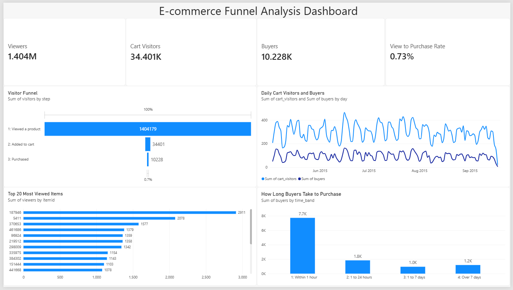

# E-commerce Funnel Analysis

An analysis of how visitors move through an online shop, from viewing a product to adding it to the cart to buying it, and where most of them drop off. Built with SQL, Python and Power BI.



## Business Problem

Most visitors to an online shop never buy. This project answers three questions:

1. How many visitors reach each step of the funnel (view, add to cart, purchase)?
2. Where is the biggest drop-off?
3. How do cart activity and purchases change over time, and how quickly do buyers decide?

## Dataset

The [Retailrocket recommender system dataset](https://www.kaggle.com/datasets/retailrocket/ecommerce-dataset) from Kaggle. The file used is `events.csv`, which records every visitor action as `view`, `addtocart` or `transaction`, with a timestamp, visitor id and item id. It covers roughly four and a half months of 2015 (May to September).

The raw file is about 90 MB, so it is not included in this repository. Download it from Kaggle to run the project yourself.

## Tools

- **SQL (SQLite):** funnel counts, daily trends, item performance and time to purchase
- **Python (pandas):** loads `events.csv` and runs the SQL file, saving each result as a CSV
- **Power BI:** interactive dashboard with DAX measures

## Key Findings

- **1,404,179 visitors viewed a product, 34,401 added to the cart and 10,228 purchased.** That is an overall view-to-purchase rate of **0.73%**.
- **The biggest drop-off is between viewing and adding to cart.** Only about **2.45%** of viewers add anything to the cart.
- **Once an item is in the cart, buying is much more likely.** About **29.7%** of cart visitors go on to purchase.
- **Most buyers decide quickly.** Around two thirds of buyers purchase within an hour of their first visit; the rest take longer, with a smaller group taking more than a week.
- **Activity follows a weekly pattern.** Daily cart visitors and buyers rise and fall in a regular cycle from June to September 2015.
- **A few items attract far more views than the rest.** The most viewed item (id 187946) had 2,911 viewers, followed by item 5411 with 2,078.

### How the funnel is counted
The funnel is strict: a visitor counts as a cart visitor only if they also viewed a product, and as a buyer only if they also viewed and added to the cart. For this reason the funnel's buyers (10,228) are fewer than the total number of people who bought at all, which the time-to-purchase chart includes.

## Dashboard

The Power BI dashboard (`powerbi/funnel_dashboard.pbix`) contains:

- KPI cards: Viewers, Cart Visitors, Buyers and View to Purchase Rate
- A funnel chart of visitors at each step
- A line chart of daily cart visitors and buyers
- The 20 most viewed items
- A chart of how long buyers take to purchase

## Recommendations

- Focus first on the view-to-cart step, where the biggest share of visitors is lost: clearer product pages, better photos and visible prices and delivery information.
- Make the cart-to-purchase step easy to finish, since a visitor who adds to the cart is already likely to buy.
- Since most buyers decide within an hour, show strong calls to action early in the visit, such as stock levels and delivery times.
- Check the most viewed items that convert poorly, as they may have price, stock or content problems.

## Project Structure

```
Project3-E-commerce-funnel-analysis/
├── sql/
│   └── 01_funnel_analysis.sql
├── python/
│   └── run_queries.py
├── results/
│   ├── q1_funnel.csv
│   ├── q2_daily.csv
│   ├── q3_top_items.csv
│   ├── q4_time_to_purchase.csv
│   └── q5_event_totals.csv
├── images/
│   └── dashboard.png
├── powerbi/
│   └── funnel_dashboard.pbix
└── README.md
```

## How to Run

1. Download `events.csv` from the Kaggle link above and save it as `data/events.csv`.
2. Install pandas: `pip install pandas`
3. From this folder, run: `python python/run_queries.py`
4. The five result files are written to `results/`. Open `powerbi/funnel_dashboard.pbix` in Power BI Desktop to explore them.
