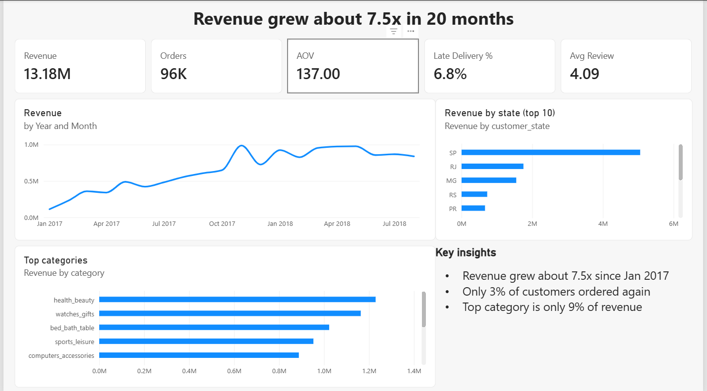
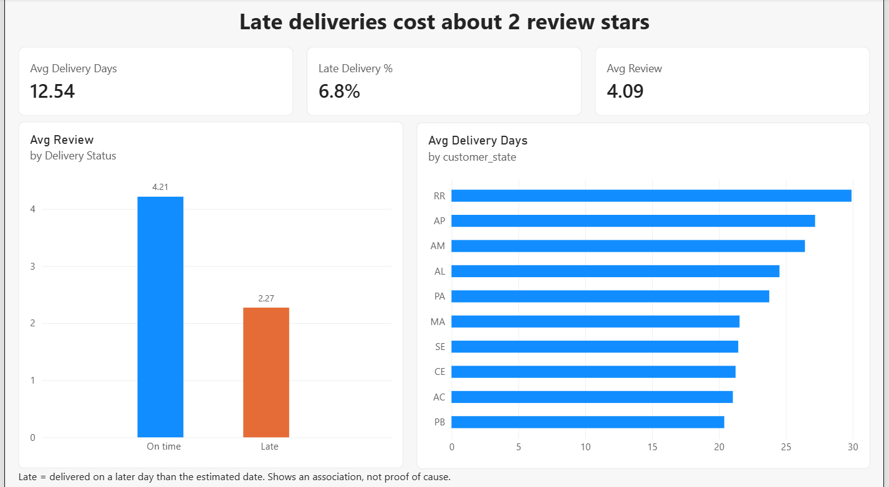

# Olist E-Commerce Analysis: Revenue, Delivery and Retention

**End-to-end data analyst project** using SQL, Python, statistics, Power BI and Excel on 100k real orders from a Brazilian marketplace (2016-2018).

> **Business question:** where does revenue come from, what hurts customer satisfaction, and how can the company grow without acquiring more customers?




## Key findings
*All numbers are generated by `scripts/build_dashboard_data.py` (see `results/key_findings.md`) and the stats notebook.*

1. **Growth:** monthly revenue grew from R$ 111,798 (Jan 2017) to R$ 838,577 (Aug 2018), +650%. Total revenue in the window was R$ 13.18M (delivered orders, item price excluding freight).
2. **Retention is the biggest opportunity:** only 3.0% of customers (2,801 of 93,358) ever ordered a second time.
3. **Delivery drives satisfaction:** late orders average 2.27 stars vs 4.29 on time (difference -2.02, 95% bootstrap CI [-2.06, -1.98]). The gap is statistically significant with a large effect size (Mann-Whitney U, p < 0.001, rank-biserial r = -0.64), and scores fall steadily with delay: 3.29 stars for 1-3 days late, 2.11 for 4-7 days and 1.70 for 8+ days. This is an association, not proof of causation.
4. **Revenue is fairly diversified:** the top 10 sellers generate 13.3% of revenue; the top category, health_beauty, is 9.3%.
5. **Geography:** delivery takes 29.4 days on average in the slowest state (RR) vs 8.8 in the fastest (SP). Overall, 6.77% of delivered orders arrive late and the cancellation rate is 0.63%.

## Recommendations
- Launch a second-purchase / win-back campaign: with only 3.0% repeat customers, even a small lift in repeat rate is worth more than the same effort on acquisition.
- Fix delivery estimates and the slowest regions first; track Late Delivery % and review score weekly. Even 1-3 days late costs about one star.
- Seller concentration is moderate (top 10 = 13.3%), so the priority is seller delivery performance rather than reducing dependence on a few sellers.

## Tools and skills shown
| Skill | Where |
|---|---|
| SQL (joins, CTEs, window functions, indexing, data-quality checks) | `sql/` |
| Python (pandas, data pipeline, cleaning) | `scripts/` |
| EDA and visualization | `notebooks/01_eda.ipynb` |
| Statistics (Mann-Whitney U, effect size, bootstrap CI, Spearman) | `notebooks/02_stats.ipynb` |
| Customer segmentation (rule-based behavioral) | `scripts/build_dashboard_data.py` |
| Dashboard (Power BI, star schema, DAX) | `dashboard/POWERBI_GUIDE.md` |
| Excel (PivotTable, charts) | `excel/olist_analysis.xlsx` |

## Metric definitions
- **Revenue:** sum of item price, *excluding freight*, delivered orders only. Total customer payments are about 1% higher than items + freight; the gap was not investigated further.
- **KPI window:** Jan 2017 - Aug 2018. Outside it the data has only a handful of orders per month (e.g. 4 orders in Sep 2016), which would distort growth rates.
- **Late order:** delivered on a later calendar day than the estimated delivery date (the estimate has no time of day, so delivery on the estimated day counts as on time).
- **Cancellation rate:** computed from the `orders` table directly (orders with no items are kept, otherwise cancellations are understated).
- **Segments:** rule-based *behavioral segmentation*, not quintile RFM, because ~97% of customers ordered only once (frequency has almost no variation). Rules: repeat (2+ orders); high-value one-time (spend in the top quartile of one-time buyers); recent one-time (last order within 90 days of the snapshot date); otherwise lapsed.

## Data quality notes
- Orders without items (unavailable / canceled) disappear in inner joins; the pipeline uses left joins.
- Some orders have several reviews; review score is averaged per order.
- The geolocation table was intentionally not used.
- *(Add anything your own checks in `sql/02_data_quality_checks.sql` find, e.g. duplicate IDs.)*

## How to run
```bash
pip install -r requirements.txt
# 1. put the Olist CSVs in data/raw/   (see data/raw/README.md)
python scripts/build_dashboard_data.py     # creates dashboard_data/ and results/key_findings.md
python scripts/make_excel.py               # creates excel/olist_analysis.xlsx
jupyter notebook                           # run notebooks/01_eda.ipynb then 02_stats.ipynb
```
**Optional PostgreSQL path** (shows SQL skills): set `OLIST_DB_URL` (see `scripts/db.py`), then
`python scripts/load_data.py` -> run `sql/01_schema_keys_indexes.sql` -> `python scripts/run_sql_export.py`.
Database: PostgreSQL.

## Repository structure
```
data/raw/            raw CSVs (git-ignored)
sql/                 schema + indexes, data-quality checks, 12 KPI queries
scripts/             pipeline (pandas), optional PostgreSQL loader/exporter, Excel builder
notebooks/           01_eda, 02_stats
dashboard_data/      tables for Power BI / Excel / Tableau
dashboard/           Power BI build guide (+ your .pbix)
excel/               workbook with pivot-ready data
results/             key_findings.md, validation_summary.json
docs/                executive summary, LinkedIn post, resume bullets, interview Q&A, data dictionary
images/              chart and dashboard screenshots
```

## Limitations
Observational data from one marketplace; review scores are self-selected; 2016 and late-2018 data are sparse; no cost or margin data, so profitability is not analysed.
