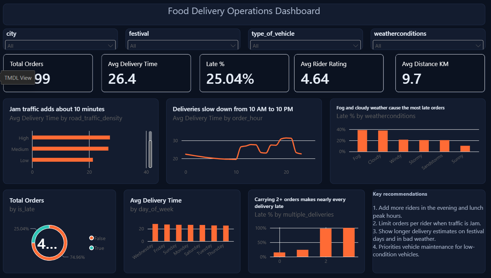

# Food Delivery Operations Analysis

**Tools:** Python (pandas, matplotlib, seaborn) | Power BI | DAX | Git and GitHub

## Project overview
Online food delivery depends on speed. A late order means an unhappy customer and a lost repeat order.
This project analyses about 45,000 food delivery orders to find **what causes delivery delays** and to recommend how to reduce delivery time.



## Business questions
1. Which factors drive delivery time: traffic, weather, distance, vehicle or carrying several orders?
2. At which hours and on which days are deliveries slowest?
3. Do weather and festivals increase late deliveries?
4. Do rider age, rating and vehicle condition affect speed?

## Dataset
- Source: food delivery dataset (Kaggle), `train.csv` with 45,593 orders
- Contains order time and date, rider age and rating, vehicle type and condition, traffic, weather, city type, festival flag, number of deliveries carried at once, restaurant and delivery coordinates, and the delivery time in minutes
- A delivery is counted as **late if it takes more than 32 minutes**

## Data cleaning (`notebooks/01_cleaning.ipynb`)
- Found hidden missing values stored as the text `"NaN "` in about 10 columns, and converted them to real missing values
- Converted delivery time from text (for example `(min) 24`) to a number and cleaned the weather labels
- Fixed impossible values: ratings of 6.0 and riders aged 15
- Fixed bad coordinates: negative restaurant latitudes, and about 3,640 rows with a restaurant location of 0, which were left empty instead of guessed
- Created new columns: `distance_km`, `order_hour`, `time_slot`, `day_of_week`, `is_weekend` and `is_late`
- Saved the result as `data/clean/train_clean.csv`

## Exploratory analysis (`notebooks/02_eda.ipynb`)
Charts for traffic, weather, city type, hour, day of week, distance, rider factors and late-order rate. All charts are saved in `images/`.

## Dashboard (`dashboard/food_delivery_dashboard.pbix`)
A Power BI dashboard with a dark theme and these parts:
- **KPI cards:** total orders, average delivery time, late %, average rider rating, average distance
- **Slicers:** city, festival, vehicle type, weather
- **Charts:** delivery time by traffic and by hour, late % by weather, on-time vs late orders, delivery time by day, and late % by number of orders carried at once
- **DAX measures:** late %, on-time %, benchmark comparison, festival and traffic comparisons

A PDF copy is in `dashboard/food_delivery_dashboard.pdf`.

## Key findings
Dashboard figures exclude orders with a missing city, weather or traffic value (about 43,800 orders).

| KPI | Value |
|---|---|
| Average delivery time | 26.4 minutes |
| Late orders (over 32 min) | 25.0% |
| Average rider rating | 4.64 |
| Average distance | 9.7 km |

1. **Carrying several orders at once is the biggest cause of lateness.** Late orders rise from about 15% when a rider carries one order to nearly 100% when a rider carries two or three at once. These groups are smaller, so treat the exact percentage with care.
2. **Traffic adds a lot of time.** Orders in jam traffic take about 31 minutes on average, against about 21 minutes in low traffic.
3. **Bad weather raises late orders.** Fog and cloudy weather have the highest late rate, at about 38%, against about 10% on sunny days.
4. **Deliveries slow down during the day.** Average delivery time is lowest in the early morning and rises from about 10 AM, with a peak near 8 PM.
5. **Day of the week makes little difference** to average delivery time.

## Recommendations
1. Add more riders during lunch and evening peak hours.
2. Limit how many orders a rider carries at once, especially in jam traffic.
3. Show longer delivery estimates on festival days and in bad weather.
4. Prioritise vehicle maintenance for low-condition vehicles.

## Limitations
- The data has no revenue, cuisine or discount information, so the project looks only at delivery operations
- Distance is a straight-line estimate from coordinates, not a road distance
- Some small groups (for example Semi-Urban cities) have few orders, so their averages are less reliable
- Orders with missing values were left out of the dashboard

## Project structure
```
Project5-food-delivery-analysis/
|-- data/
|   |-- raw/          original files (train.csv, test.csv, Sample_Submission.csv)
|   `-- clean/        train_clean.csv
|-- notebooks/
|   |-- 01_cleaning.ipynb
|   `-- 02_eda.ipynb
|-- images/           charts and dashboard screenshot
|-- dashboard/        Power BI file and PDF export
`-- README.md
```

## How to run
1. Clone the repository
2. Install the libraries: `pip install pandas numpy matplotlib seaborn jupyter`
3. Run `01_cleaning.ipynb`, then `02_eda.ipynb`
4. Open `dashboard/food_delivery_dashboard.pbix` in Power BI Desktop

## Author
**Yash Zade**, B.Tech in Artificial Intelligence and Machine Learning
Email: yashzade0705@gmail.com | GitHub: [yashzade0705-stack](https://github.com/yashzade0705-stack)
