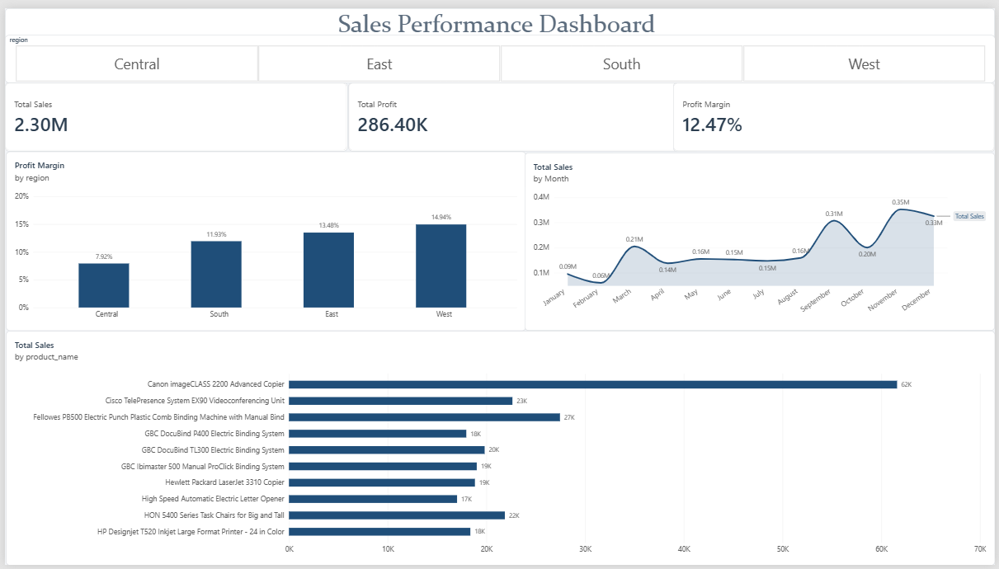
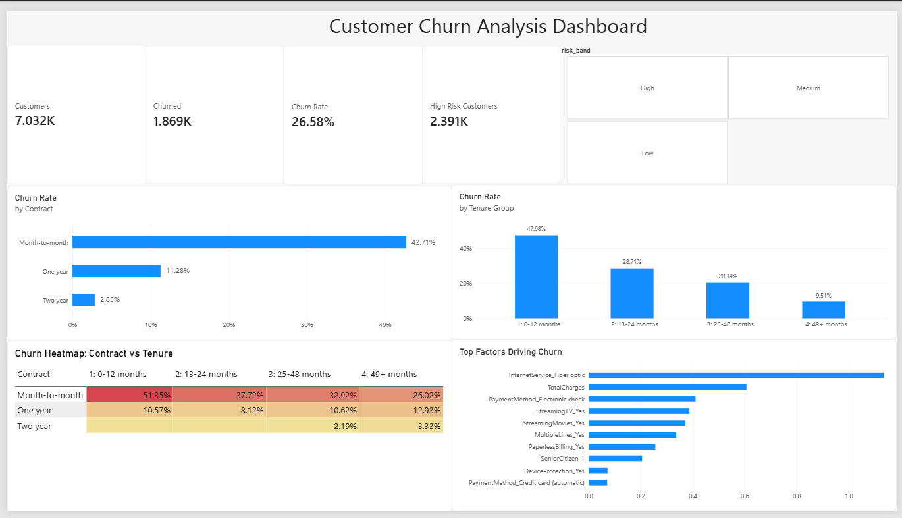

# Data Analyst Portfolio

Hi, I'm Yash Zade, an aspiring data analyst. This repository holds my portfolio projects built with SQL, Excel, Python and Power BI.

## Projects

### 1. Sales Performance Dashboard

Analysis of 9,994 retail orders (2014-2017) to find which regions underperform and which products drive sales.

[Open the full project](Project1-sales-dashboard)

### 2. Customer Churn Analysis

Analysis of 7,032 telecom customers: 26.58% churn, driven mainly by month-to-month contracts and short tenure. Includes a Python prediction model (recall 79%, ROC-AUC 0.835) and a Power BI dashboard.

[Open the full project](Project2-churn-analysis)

### 3. E-commerce Funnel Analysis

Funnel analysis of 1.4M website visitors (viewed, added to cart, bought): overall conversion is 0.73%, with the biggest drop at the view-to-cart step. Built with SQL and Power BI.

[Open the full project](Project3-E-commerce-funnel-analysis)

## About Me

- Tools: SQL, Python, Excel, Power BI
- GitHub: yashzade0705-stack
